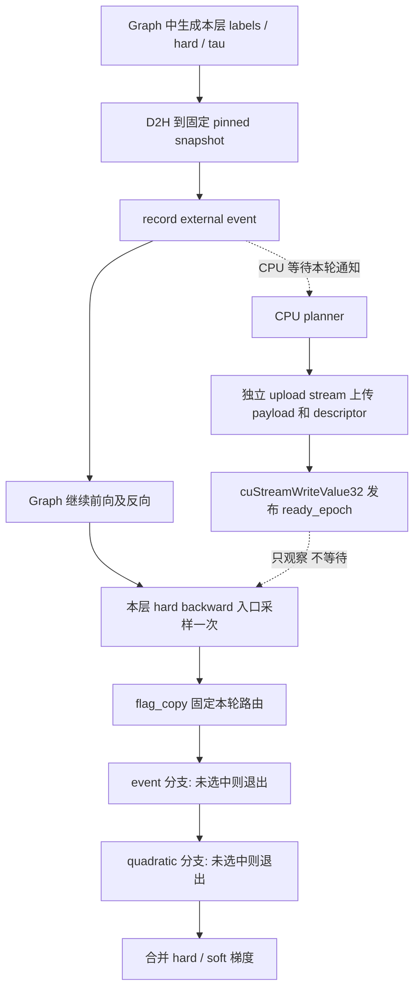

# Planner 启用时的 CUDA Graph：设计与阶段计划

记录日期：2026-10-23。代码基线：`510b3eb`。

状态：**P2/P3/P4 已实现独立 runtime 和 hard backward API，验证见第 10 节。**
P5/P6 模型/runner 接入尚未开始，`PackedTrainingGraph` 仍要求
`DISM_HARD_PLANNER=0`。设计文档首次提交为 `b2da895`；P1 结果见第 9 节。
不据此宣称整模型 planner graph 已支持；默认开关不变，暂不做性能优化。

## 1. 目标和范围

在保留整段 microbatch 前向和反向 CUDA Graph 的前提下，让图外 CPU planner
为**本次 replay**生成计划；在每层 hard backward 入口由 GPU 采样是否就绪，
在 event-based hard backward 与 quadratic fallback 中选择一条执行。

首个集成目标为当前 packed、固定 true direction、sequence-row hard sampling、
BF16/MXFP8 FFN 模型：compact planner、C64、R32/DV64，策略为 `ready`。
初版保持同一个 runner 顺序执行，不支持重入或多个 replay 同时在途。
其它维度、classic metadata、强制等待的 `event` 策略需要单独验证或明确拒绝，
不能静默改变其语义。现有 eager planner、planner-disabled graph 保持可用。

必须保持：

- postnorm、前半 GDN/后半 GDN+DISM、固定 true direction、按原始训练行采样。
- soft/hard 数学、tau 梯度算法、BF16 补偿及已有数值验收标准。
- RNG counter、annealing buffers、参数别名、no-decay 分组、optimizer schema。
- checkpoint 的 consumed dataloader position；runtime graph/planner 状态不进 checkpoint。
- 词表 TMA 融合实验默认关闭。本任务不包含它，也不要求吞吐提升。

## 2. 已确认的现状

启用 `DISM_HARD_PLANNER=1` 时，默认是 compact + ready，16 workers、C64、
最多 32 个存活 ticket。当前流程为插值生成 labels → 保存 labels/hard/tau
快照 → D2H → CPU planning → metadata H2D → 反向在 host 检查就绪状态。
`future.done()` 只表示 CPU 工作结束；最终上传 event 完成才允许选择 event 路径。

主要代码入口：

| 入口 | 当前职责 / 后续涉及的变化 |
|---|---|
| [hard_training.py](../python/flash_dism/hard_training.py) | 单次调用 ticket、CPU coordinator、快照、ready/event/quadratic 路由 |
| [training_planner.py](../python/flash_dism/inference/training_planner.py) | native plan、动态 compact storage、上传与资源所有权 |
| [hard_backward_fused.py](../python/flash_dism/kernels/hard_backward_fused.py) | compact consumer、动态 grid、跨 stream event wait、tau reduction |
| [hard_backward.py](../python/flash_dism/hard_backward.py) | quadratic fallback 的 forward-state 重计算及反向 |
| [compiler.py](../python/flash_dism/compiler.py) | core/vocabulary custom op、saved tensors、两路梯度合并 |
| [frontend.cpp](../src/frontend.cpp) | CPU tensor Storage 持有 ticket 的 opaque handle |
| [graph_layout.h](../include/host/graph_layout.h) | 可复用的 packed metadata ownership、固定容量和 replay 前更新 |
| [cuda_graph.py](../../nanochat/nanochat/cuda_graph.py) | 整步 capture/replay、输入 staging、grad accumulation、当前固定 quadratic 路由计数 |

本轮信息收集运行了 ready dispatch、training defaults 和预生成计划 graph 测试，
共 **23 passed**。直接捕获未经修改的 compact consumer，在
`stream.wait_event(self.ready)` 复现 `cudaErrorStreamCaptureIsolation`，
随后 capture end 报 invalidated。已有 fused graph 测试先完成上传并移除
`device_plan` 等待，只覆盖固定计划下改变向量值的 replay，不能证明异步交接可用。

计划尺寸也不只由 token shape 决定。小型探针固定 B=2/H=2/N=512、C64：

| 输入 | 单 chunk blocks | 多 chunk streams / chunks | metadata bytes |
|---|---:|---:|---:|
| 随机 labels、全 hard | 702 | 0 / 0 | 185,336 |
| 重复 labels、全 hard | 5,032 | 52 / 168 | 1,580,280 |
| 全 soft | 0 | 0 / 0 | 8 |
| 随机 labels、改变文档边界 | 559 | 0 / 0 | 147,584 |

这些是结构探针，不是性能结果，也不是容量上界。

## 3. 选定的执行协议

以下操作按每个 hybrid layer、每次 replay 分别进行。`epoch` 是 runtime
generation，不是模型 RNG counter，也不替代 checkpoint 中的训练步。



### 3.1 Graph 到 CPU 的通知

Graph 拥有固定地址的 device snapshot 和 pinned host snapshot，D2H 完成后
记录 external event。当前 PyTorch 有 `torch.cuda.Event(external=True)`。
CUDA 的 event record node 会随每次 graph launch 重新记录；普通 capture event
可能只形成图内依赖，不能把它当作已实现的 CPU 通知协议。
参见 [CUDA 13.1 graph event record](https://docs.nvidia.com/cuda/archive/13.1.0/cuda-driver-api/group__CUDA__GRAPH.html)。

Host 在 `replay()` 提交返回后，才允许 coordinator 等待对应层的本轮 event。
必须验证重复 launch 时的 event 状态及 epoch 对应，不能让提前等待的线程读取
上轮完成状态或尚未记录的 event。每层通知独立；coordinator 派发任务后继续
处理后续层通知，不在同一通知循环里串行等待一个层的整个规划过程。

第一版可把 D2H 节点排在 graph 的执行链上；若以后改为旁支 copy stream，
必须单独验证 capture fork/join 和 snapshot 被复用前的依赖。
文档边界由 replay 前的 CPU staging 提供**本轮私有快照**，不能让后台任务
继续读取下一轮会被修改的 `layout.table`。

### 3.2 CPU 到 GPU 的发布

CPU planning 完成后，在独立的 nonblocking upload stream 上依次提交：

1. 本轮完整 metadata payload 和必要的派生数组上传/构建。
2. 本轮 descriptor 上传，其中包含 epoch、有效任务数和 payload/workspace 指针。
3. `cuStreamWriteValue32(..., ready_epoch, epoch, 0)`。

`ready_epoch` 的含义是“该 generation 的数据已可供消费”，不是“CPU 已算完”。
不能把 flag 写在 H2D 之前，也不能把它排在整步 graph 之后的同一个 stream 上。
采用正常 device memory、对齐的 32-bit flag；检查调用返回值和设备/API 支持。
默认 write 带前置 stream-scoped fence，不使用去掉 barrier 的选项。
参见 [CUDA 13.1 stream write flags](https://docs.nvidia.com/cuda/archive/13.1.0/cuda-driver-api/group__CUDA__TYPES.html)。

采样端需要与发布端匹配的可见性/ordering 协议。阶段 1 必须明确 acquire load
的 scope、编译后的指令及后续 consumer 的依赖，证明“观察到本轮 ready 就能
读到本轮完整数据”。不能用普通 load、`volatile`、经验测试通过或多加一个 fence
替代这项论证。若 `WriteValue32` 与选定消费原语的正式保证不足，先修订此小协议，
不把不明确的同步关系带入模型。

### 3.3 一次采样和互斥执行

在每层 soft backward 后、hard backward 前运行一个采样节点：

```text
flag_copy[layer] = (acquire_load(ready_epoch[layer]) == expected_epoch)
```

该节点完成后，两个分支及其所有 CTA 都读取同一个 `flag_copy`。
它在本轮消费完成前不可改写；不能由两个分支分别读 live ready flag。
采样后迟到的发布只影响资源回收，不能把当前 fallback 变成 event 路径。
采样不通过时不得解引用尚在上传的 descriptor 或 payload。

初版将两个分支顺序放在 graph 中，不要求并发。persistent/fixed-grid consumer
只遍历采样时已就绪的有限任务，未选中立即退出；不轮询等待 CPU，不在 GPU 上
用 `cuStreamWaitValue32` 等待 planner。CUDA 调度器不能根据内存 flag 推导调度
依赖，不能让正确性依赖跨 stream 并发执行或特定优先级。
参见 [CUDA 13.1 stream memory operations](https://docs.nvidia.com/cuda/archive/13.1.0/cuda-driver-api/group__CUDA__MEMOP.html)。

新的 `ready` 决策发生在 GPU 实际执行到该层时，旧实现发生在 CPU 提交反向时。
二者可能选择不同路径，因而不要求路径比例或浮点结果逐位相同；要求每一条被选
路径都消费同次前向的数据，并通过原有数值标准。强制等待的 `event` 策略不是
此协议的自动延伸，首版 graph 接口应明确限制策略。

## 4. 存储、生命周期与失败处理

### 4.1 首版资源模型

先采用**每个 graph instance 的每层一个固定 slot**。一个 slot 的固定部分包括：
device/pinned snapshots、external input-ready event、device expected/ready epoch、
`flag_copy`、device descriptor、路由结果和消费完成标记。多 slot ring 不是首版目标。

Graph kernel 参数保持固定的 descriptor 地址；descriptor 可提供本轮 compact
16/32/64 桶和 multi-stream 的指针、计数、offsets、tau-head mapping、workspace。
payload 和 workspace 在图外分配并由 runtime 保活，或者使用显式容量的 arena。
第一版优先验证 descriptor 间接寻址，不能声称 persistent launch 自动解决了存储问题。
不直接把 Python tensor 的可变 shape/指针固化为 graph kernel 参数。

所有容量、索引宽度和字节大小都需要检查；不能截断计划。显式配置的资源预算不足
可以记录原因并走 fallback；内存损坏、CUDA 错误和 planner 异常不能当作普通未就绪。
给在途 ticket 数量和总 metadata/workspace 字节都设置边界。

### 4.2 generation 与回收规则

每轮开始前设置新的非零 32-bit epoch；0 保留为未发布。epoch 回绕前必须完全排空
runtime 并重置 generation，不能让旧值重新匹配。generation 检查本身不保护 payload。

一个 slot 只有同时满足以下条件才可以复用、清零或释放：

- 本轮 graph 不再读取它，D2H 及所有消费节点已经完成。
- CPU coordinator/native workers 已停止读取 pinned snapshot 和文档快照。
- 已提交的 metadata H2D、派生工作及 flag write 都已结束。

即使 GPU 已选 fallback，迟到的 CPU/H2D 仍可能持有或写入此 slot。
不能仅凭 graph 完成就复用它，也不能只比较 epoch 后覆盖 metadata。
初版允许在**下一轮 replay 前的回收点**等待这些资源安全退役，以简化正确性；
这可能引入 CPU 时间，暂不优化。以后采用多 slot 必须同时设计 graph 捕获地址
与 slot 绑定方式，不能直接让 ring index 指向不同 pinned copy 目标。

任务阶段（D2H、planning、uploading、published、drained）与 GPU 路由结果
（未采样、event、quadratic）是两个独立状态，不能简化成一条线性状态链。
fallback 可以与 planning/uploading 同时发生。

### 4.3 异常、取消与训练边界

取消只能阻止尚未开始的工作或尚未提交的上传。不得释放已经排队的 copy 源/目标，
不得用 `Future.cancel()` 假装 CUDA 工作已结束。正在运行的 native 工作先 drain。
关闭 runner、capture 失败、提前丢弃模型、切换 evaluation 和 checkpoint 保存都
需要明确的 drain/close 路径；关闭过程不能依赖一个从未提交的 replay event。

CPU 错误进入独立 error channel，不发布 ready。GPU 可安全完成 fallback，但 host
必须发现错误并拒绝把失败步骤提交到 optimizer/checkpoint，不能静默忽略。
首版在 optimizer 更新前 drain 本步骤的剩余任务并检查错误；这是明确的正确性边界，
不是承诺无等待。资源预算导致的预期 fallback 与真实异常分别计数。

Runtime generation、slots、worker queues 和 graph handles 都不序列化。
恢复 checkpoint 后重建它们，完整保留模型 RNG、annealing、optimizer 和数据位置。

## 5. Kernel 改动边界

Event consumer 保留现有 compact 分桶、BF16 补偿、one-pair 分支、reset 语义和 tau
计算。改动集中于固定 grid、device task count、descriptor 间接寻址和统一分支门控。
single chunks、multi summaries、stream scan、multi chunk backward、tau reduction
仍可保留为多个节点，以节点依赖提供阶段间全局同步。不要引入普通 CTA 之间的
自旋全局 barrier。各阶段计数器/workspace 初始化必须每轮执行且符合门控规则。

[历史算法实验](PLANNER_BACKWARD_ALGORITHM_ANALYSIS.md) 中的 `persistent_tf32`
已因性能和数值问题被否决。这里的 persistent 仅用于固定 launch 下的动态任务遍历，
不继承那套数学或精度路径，也不因名称相同就视为已有实现。

Quadratic 门控覆盖整个 fallback：hard summary/chunk/log weights/readout 重计算、
反向主 kernel、dlog/tau reduction 及必要的合并。只门控主 backward 不够。
初版可为两路分别保留固定输出，先统一清零，再由被选中分支写入并合并；
未选中路径不得读无效 payload，也不得清除另一条路径已经写入的结果。

门控应在 TMA 发起、barrier 初始化或 shared pipeline 使用前由 CTA 一致地决定。
kernel 修改按仓库规则检查边界/同步、CALL/spills，运行相应 sanitizer；不使用
shared FP32 atomicAdd，不修改已有默认 launches 来追求性能。

## 6. 分阶段实施与验收

每个阶段应形成可独立审查的提交，包含实现、必要回归和文档结果；生产接入在后面。
验收失败先修复本阶段，不通过放宽 tolerance、默认强制 fallback 或隐藏异常进入下一阶段。

| 阶段 | 交付内容 | 依赖与退出条件 |
|---|---|---|
| P0：设计记录 | 本文、现状证据、接口边界与验收清单 | 已提交 `b2da895` |
| P1：最小交接协议 | 不含 DISM 的 D2H/external event/CPU producer/H2D/WriteValue32/一次采样/双分支探针 | 当前环境单 slot 探针通过，见第 9 节 |
| P2：slot 与真实 planner runtime | 固定 snapshot、epoch/descriptor ownership、现有 native planner 接入、上传、回收、错误通道 | 独立 API 已实现；快照、预算、退役和错误路径验证见第 10 节 |
| P3：固定 launch 的 event consumer | descriptor 驱动 compact 各阶段、动态有效任务数、workspace/tau 处理 | 独立 API 已实现；同图动态计划、原 compact/FP64 对照见第 10 节 |
| P4：完整双路径门控 | quadratic 全链路门控、共享采样结果、输出初始化/合并 | 独立 API 已实现；完整 native fallback 门控、packed/双路径测试见第 10 节 |
| P5：DISM core/vocabulary 接入 | capture 专用 runtime binding、D2H 节点、保存状态和梯度合并 | 基于 P2/P4；单层及多层完整前向反向，连续改变 labels/masks/tau/boundaries，旧 eager/AOT 回归通过 |
| P6：nanochat runner 接入 | replay 调度、预热与 capture、累积梯度、optimizer 前错误检查、实际 GPU 路由统计 | 基于 P5；小模型后再到当前模型，RNG/恢复/数据位置保持，限定支持组合并显式启用 |
| P7：完整验收与交付 | 跨轮压力、异常生命周期、数值与 sanitizer 证据、运行文档 | 所有必需项完成后才声明支持；保留默认 planner-disabled 行为，不做吞吐优化 |

### P1：先解决同步原语，不碰模型

在 `tools/` 放可复现的最小工具，`tests/` 放协议回归；native host 绑定和 CUDA TU
按现有 `build.py` 接入，device TU 保持 Torch-free。使用受控的 CPU gate 和 GPU
完成通知安排 ready/fallback 情况，不用依赖机器快慢的 sleep 作为唯一测试依据。
边界竞态允许选中任一合法分支，但必须全局一致、payload 完整，且不能重复写结果。
外部 event 与 WriteValue 的连通性是后续设计的首个验证门槛；已完成的 P1
探针及覆盖范围见第 9 节。

### P2：先用轻量 consumer 检验真实计划

复用现有 `NativeTrainingPlanner` 的数学和 packing。初期 consumer 只检查 descriptor
与 metadata 内容，尚不计算真实梯度。验证逐轮从空计划变为 short/long/repeated
计划、文档数变化、CPU 输入快照不被修改，及有/无提交上传的取消路径。
Warmup/capture 与真实 replay 必须有独立状态：不能在 capture 时等待尚未执行的 D2H，
也不能让 warmup 的 ticket、错误或 generation 泄漏进第一轮训练。

### P3/P4：把数学验证与调度验证分开

P3 用图外预生成/上传的计划，单独证明 consumer 能读取新的 counts、指针和内容。
逐个改造短桶、multi summaries/scan/chunks、tau reduction，避免同时重写全部阶段。
P4 再接一次采样与完整 quadratic 分支；测试可在图外预发布或延迟发布以控制路由，
不为生产引入“强制 event 且 GPU 等待”的隐式新策略。

数值基线分别取原 compact consumer、原 quadratic 路径和 FP64 oracle。
保留 [precision](PLANNER_BACKWARD_PRECISION.md)、
[algorithm limitations](PLANNER_BACKWARD_ALGORITHM_ANALYSIS.md) 中已有失败诊断。
路由切换允许浮点次序差异，但新差异不能未经比较就归类为历史限制。

### P5/P6：逐层再整模型

先验证 core，再验证 vocabulary custom op，最后接模型。CPU tensor handle 可以继续
承载所有权，但不能沿用“capture 时创建一次 Future，replay 自动重新提交”的假设。
runtime binding 必须由 graph instance/layer 明确持有，不能建立裸指针全局 registry。

再接 `PackedTrainingGraph` 与训练循环：保留已有输入、packed layout、GDN、MXFP8
和梯度存储约束；每次 replay 只增加一次模型 RNG counter，预热/capture 恢复现场。
GPU route 结果在安全的日志/步骤边界读取，替换当前重放后固定记录 `q` 的逻辑。
实际 planner 异常在 optimizer 前上报；拒绝不支持的 policy/shape/lifecycle 组合。
正式 CLI 命名在本阶段确定，不能提前移除现有 planner capture guards。

## 7. 验收清单

| 方面 | 必须覆盖的情况 |
|---|---|
| 通知/发布 | external event 多轮复用、每层通知、payload/descriptor 上传顺序、采样前后完成、上传中采样、发布与采样竞争 |
| generation | 不发布、旧 epoch、跨轮迟到、drain 后复用、回绕策略；epoch 匹配不能掩盖错误 payload |
| 计划结构 | 全 soft/全 hard/混合原始行、random/repeat labels、空桶、多 chunk、不同 counts/指针、资源不足 |
| packed 语义 | changed/reused cu_seqlens、空文档、文档数量变化、256 对齐、跨原始训练行的非法文档拒绝 |
| 双路径 | event/quadratic 交替、迟到发布、两路输出完整性、tau/zero-grad、无重复累加、无未选中分支副作用 |
| 生命周期 | 多层、早期丢弃、未启动 replay、capture 失败、CPU exception、CUDA upload error、close、allocator 复用压力 |
| 数值 | 各路径独立 FP64 oracle、原路径对照、原 tolerance；记录 cosine/norm/偏差及未解决的 strict failures |
| 模型状态 | microbatch accumulation、两种 zero_grad、RNG/annealing、MXFP8 更新、evaluation 后恢复、checkpoint/resume 与 consumed data position |
| 工具检查 | 改动 kernel 的 memcheck/synccheck/racecheck、CALL/spills、工作树 imports、没有新增不受限内存增长 |

对异步交接的压力测试不能替代内存模型论证；sanitizer 零报告也不等于已证明
CPU/DMA 与 GPU flag 协议的全部跨域 ordering。保存测试范围和局限。

只用 conda `blkw` 和本工作树的 `flash_dism`/`cu_flash_dism`；native build 并行度
有界。测试使用 scratch 模型和合成数据，不下载数据、不启动外部训练、不修改用户
checkpoint。生成的日志、JSON、trace、cubin/SASS 放在忽略的 `dism_v3/build/` 下。

## 8. 待阶段内确认的问题

- P1：WriteValue32 发布与所选 acquire load/consumer 节点之间的完整内存顺序；
  external event 重录与 CPU 等待的本轮绑定，以及目标 CUDA/PyTorch API 的支持。
- P2：descriptor 的具体 ABI、错误通道、字节预算和同步退役接口。首版不承诺无等待回收。
- P3：运行时指针与 TMA/编译器约束；如需要 descriptor 或 map 更新，必须在发布前完成，
  不能暗中把旧指针捕获到 graph。各阶段固定 grid 大小先取保守值，不选性能最优值。
- P5/P6：正式 opt-in 接口、暂不支持的 policy/尺寸、checkpoint/evaluation drain 的确切位置。
- P7 之后：只有功能验收完成，再另行讨论多 slot overlap、队列调度、launch 数量和性能。

相关背景：[CUDA Graph 当前支持](CUDA_GRAPHS.md)、
[ready dispatch](HARD_READY_DISPATCH.md)、
[native planner](NATIVE_TRAINING_PLANNER.md)。

## 9. P1 同步可行性验证（2026-10-23）

结论：当前 RTX 5090 / SM120、PyTorch 2.13.0+cu130、Triton 3.7.1 环境下，
**图内 D2H/external record → 图外 CPU → H2D/WriteValue32 → 图内采样/双分支**
的单 slot 协议可运行，并能在同一次完整 graph 尚未结束时完成交接。
这不是吞吐结果，也没有接入真实 DISM 梯度或 CPU planner。

代码：[check_planner_graph_sync.py](../tools/check_planner_graph_sync.py)，
回归：[test_planner_graph_sync.py](../tests/test_planner_graph_sync.py)。
探针用 ctypes 调用 `libcuda.so.1` 的 `cuStreamWriteValue32_v2`，小型 GPU kernel
用 Triton 编译，因此此阶段无需新增 native binding、修改 `build.py` 或重编生产扩展。
后续生产 host API 的位置仍在 P2 决定。

### 9.1 原语与内存顺序

实际采用以下发布链：

```text
upload stream:
  payload H2D -> descriptor H2D -> cuStreamWriteValue32_v2(ready, epoch, 0)

sampling kernel, thread 0 publishes the decision:
  ld.acquire.sys.global.u32 ready
  compare with expected epoch
  st.release.sys.global.u32 flag_copy

each selected consumer CTA:
  ld.acquire.sys.global.u32 flag_copy
  if selected: read descriptor, then payload
```

推理依据是 CUDA API 的同 stream 顺序、WriteValue32 默认写前 fence，以及 PTX
release/acquire 的传递性。采样线程观察到本轮 ready 后，其 release 将这一关系
传给 consumer 的 acquire，避免只在采样线程 acquire、其它 CTA 却无明确 acquire
地解引用计划。参见第 3 节的 CUDA API 文档及
[PTX release/acquire 与 API synchronization](https://docs.nvidia.com/cuda/parallel-thread-execution/index.html#memory-consistency-model)。

采样 CTA 的各 lane 可能在发布边界读到不同的 live flag，因此只有 thread 0
允许写 `flag_copy`；consumer 读取的是随后保持不变的副本。编译后的 PTX 保留
`ld.acquire.sys.global.u32` / `st.release.sys.global.u32`。SASS 中可见
`LDG.E.STRONG.SYS`、`CCTL.IVALL`、`MEMBAR.ALL.SYS`、`STG.E.STRONG.SYS`，
且非发布线程在 release store 前退出。event consumer 在加载 descriptor 前
检查选择并退出，不会在 fallback 时提前加载尚未发布的指针。

以上论证依赖 CUDA 对 stream write fence 的公开保证；没有自行形式化驱动的内部
DMA 实现。测试验证该组合在当前环境的行为，不作为所有 CUDA 版本/平台的普遍证明。
此协议没有 GPU wait-value 或等待 CPU 的自旋循环，因此正确性不依赖 upload stream
一定能抢在 graph 前执行：未赶上本次采样就执行 fallback。

### 9.2 受控检查与异步压力

每轮输入由 graph 中的小 kernel 生成，并 D2H 到固定 pinned storage；CPU 读取后
精确检查全部 256 个 int32，确保 external event 对应本轮内容。CPU 根据这份快照
构造 payload 和带指针/长度/epoch 的 descriptor，交替使用两块 GPU payload 存储。
固定 32 CTA 的 consumer 用运行时长度做 grid-stride 遍历。

每个结果检查所有有效输出、未触及尾部的 sentinel，以及每个 CTA 的分支执行标记。
不是只检查 ready flag。ready 不在每轮清零，专门验证旧 epoch 不能被误认。
容量为 1,048,576 个 int32（4 MiB），长度覆盖 0、1、255、256、257、capacity-17、capacity。

受控检查使用同一组 slot 的三个分段 graph，确定性覆盖：

- 完整上传后才采样：必须 event，payload 与 descriptor 都来自本轮。
- 先采样、再完成上传、最后执行 consumer：live flag 已变 ready，仍必须 fallback。
- descriptor 已有效但 payload 只写了半份，尚未发布：必须 fallback；完整发布不能
  改变先前决定。
- 保留旧 ready、把 descriptor 置零：必须 fallback，不能解引用空指针。

另外使用单个完整 graph 验证实际异步交接。CPU worker 仅在 graph launch 返回后
提交并等待本轮 external event。有限的 `torch.cuda._sleep` 只用于制造不同的计算
窗口，既不读取 CPU flag，也不等待 producer；受控用例不以这些窗口来保证时序。
每五轮中的一轮故意等 graph 结束后再启动 producer，确定性验证迟到发布和退役。

| 运行 | 窗口 cycles | 完整 graph 轮数 | 另加受控检查 | 实际异步尝试的 event / fallback | graph 结束后才发布的轮数 |
|---|---:|---:|---:|---:|---:|
| `stress_window.json` | 20,000,000 | 600 | 28 | 480 / 0 | 120 |
| `stress_no_window.json` | 0 | 600 | 28 | 0 / 480 | 120 |
| `stress_racing.json` | 1,000,000 | 300 | 28 | 75 / 165 | 60 |

共 **1,584 次结果检查通过**。短窗口同时出现两种合法路由，没有分支混用、半份
数据消费或旧 generation 的输出。无窗口时直接 fallback，producer 缺席不阻塞 GPU。
异步路由比例受调度和插桩影响，不作为 pytest 的时延断言。

8 项 pytest 回归通过，还包括无 producer 仍完成、CPU 快照校验异常向调用者传播、
`0xffffffff` 旧 tag 拒绝。正向 fixture epoch 使用小的正整数；没有据此声明 generation
回绕、并发 replay、多层协调或真实 planner 异常生命周期已验证，这些属于后续阶段。

### 9.3 编译产物与检查范围

| Kernel | registers | spills | CALL |
|---|---:|---:|---:|
| snapshot producer | 12 | 0 | 0 |
| sampler | 10 | 0 | 0 |
| event consumer | 21 | 0 | 0 |
| fallback consumer | 16 | 0 | 0 |

CUDA 13.1 Compute Sanitizer 对全部 8 项回归分别检查：memcheck 0 errors，
synccheck 0 errors，racecheck 0 errors / 0 warnings / 0 hazards。没有过滤 kernel
或抑制报告。racecheck 主要检查 shared-memory hazards，不能将其零报告解释为对
全局内存 flag 与 DMA 发布协议的独立证明；该部分依据上面的 API/PTX 顺序论证和
逐元素协议测试。探针不使用 shared-memory 协作 pipeline。

PTX/SASS/cubin、JSON 和检查日志保存在忽略的 `build/planner_graph_sync/`。
探针没有 DISM 数学、TMA consumer、shared pipeline 或训练 state mutation；其结果
不能替代 P3/P4 的真实反向 kernel 检查，也不能证明 GPU flags 之外的完整 runtime
生命周期正确。

### 9.4 复现

从工作树根目录，在 conda `blkw` 中运行；JSON 输出必须使用新路径：

```bash
export PYTHONPATH="$PWD/dism_v3/python:$PWD/nanochat"
export OMP_NUM_THREADS=1
python -m pytest dism_v3/tests/test_planner_graph_sync.py -q
python dism_v3/tools/check_planner_graph_sync.py \
  --rounds 600 --capacity 1048576 --window-cycles 20000000 \
  --output dism_v3/build/planner_graph_sync/reproduce_window.json
python dism_v3/tools/check_planner_graph_sync.py \
  --rounds 600 --capacity 1048576 --window-cycles 0 \
  --output dism_v3/build/planner_graph_sync/reproduce_no_window.json
python dism_v3/tools/check_planner_graph_sync.py \
  --rounds 300 --capacity 1048576 --window-cycles 1000000 \
  --output dism_v3/build/planner_graph_sync/reproduce_racing.json
/usr/local/cuda-13.1/bin/compute-sanitizer --tool memcheck --error-exitcode 86 \
  python -m pytest dism_v3/tests/test_planner_graph_sync.py -q
```

synccheck/racecheck 使用相同命令替换 `--tool`。无需设置 planner 环境变量；本工具
不调用 planner，不改变其默认开关，也不创建模型、checkpoint 或 dataloader。

## 10. P2/P3/P4 实现（2026-10-23）

实现入口：

- [planner_graph.py runtime](../python/flash_dism/planner_graph.py)：真实 native
  planner、固定 slot、独立 upload stream、发布和退役，以及 standalone 双路径 API。
- [planner_graph.py kernels](../python/flash_dism/kernels/planner_graph.py)：一次采样、
  descriptor 驱动的 compact 各阶段及 tau 汇总。
- [graph_route.cuh](../include/common/graph_route.cuh)：native quadratic 的 acquire
  门控；host 通过可选 `choice` 参数传入。省略参数时保持 eager 调用行为。
- [test_planner_graph.py](../tests/test_planner_graph.py)：真实计划、数值和生命周期回归。

### 10.1 P2：所有权及接口

`GraphPlannerRuntime` 显式创建，不加入默认 dispatcher，也不序列化。首版仅支持
compact C64、BF16 R32/DV64、per-head tau、ready 语义。native planner 的 packing
和数学保持不变；不支持的 graph 组合明确拒绝。

每个 slot 固定持有 pinned/device labels/hard/tau、external input/finished events、
expected/ready epoch、choice 和 64 个 int64 的 descriptor。`snapshot()` 只排入
GPU copy/record 节点，不提交 CPU 工作；warmup/capture 不创建 ticket 或 Future。
`arm(layout=...)` 在 replay 前排空旧 generation，并拷贝本轮 CPU 文档表。
Packed BH(T) labels 还原成原始训练行的 `[2, rows, heads, row_tokens]`，hard mask
仍按原始行索引，不按文档重新采样。

推荐调用顺序：

```python
# 在同一个 CUDA stream 上 warmup/capture/stage/replay；packed table 也属于该 stream。
# graph 的主体是 snapshot(...), backward(...), finish()，不含 CPU planning。
slot.arm(layout=layout)
runtime.replay(graph)  # graph launch 返回后才派发本轮 CPU 工作
runtime.drain()        # 必须先检查后台错误，再允许 optimizer/checkpoint 修改
```

`runtime.replay` 在提交任何 CPU 任务前标记所有参与 slot 为 GPU 在途，线程池提交
失败也会等待 GPU 退役。低层 `launched()` 保留给分段协议探针；手工 replay 的调用者
必须在 launch 返回后通知 runtime，或自行等待 GPU 完成，不能直接丢弃仍在写 pinned
snapshot 的 graph。每个 slot 的 `finish()` 必须位于其所有 GPU 消费之后。

每 slot 独立等待 external event 的任务共享有界 native pool，因此一层的 CPU
planning 不阻塞其它层的通知派发。每 slot 只允许一个 generation；`arm` 回收旧
GPU、CPU、upload 后才复用。非零 uint32 epoch，回绕时 drain 后清零 ready；高位
epoch 在 int32 tensor 中保留原始位模式。没有 GPU wait-value 或自旋等待。

`max_slots` 限制存活 slot；`max_bytes` 等分为每 slot 预算，覆盖固定 tensor 快照、
host/device payload、辅助 indices、descriptor、矩阵 workspace 和 tau partials。
metadata 超预算在 pinned packing 前拒绝，workspace 超预算在 GPU 分配前拒绝。
这些是明确记录原因的 fallback。预算不包含 native 算法临时 CPU working set、
CUDA allocator 缓存、graph 自有分支输出及 quadratic workspace；它不是进程内存硬上限。
索引检查覆盖 token/vector 和 chunk/width 的 int32 乘积，不能截断任务数。

取消只跳过尚未开始的 planning/upload；已经排队的 H2D、发布及 GPU 消费仍退役。
CPU/CUDA/提交异常进入 sticky error，`drain/close` 上报，失败 slot 不可再次 arm。
上传中途异常也先同步 upload stream，再释放 copy 的 pinned/device owners。
必须显式 `close()` 或使用 runtime context manager；P5/P6 再把这些边界接到模型退出、
evaluation、optimizer 和 checkpoint。当前 standalone API 没有自动更新训练状态。

### 10.2 P3：descriptor 与固定 launch

ABI v1 是四个 16-word int64 record，依次对应 16/32/64 短桶及 multi：

```text
[chunks, streams, rows*, prefixes*, weights*, dlog*, lengths*, heads*,
 offsets*, resets*, chunk_ids*, chunk_owners*, H*, G*, alpha*, tau_partials*]
```

`*` 为 device pointer。epoch 保存在 slot 的 expected/ready word 中，不重复写入
descriptor。空 record 允许 null pointers。完整 payload/indices 和 descriptor H2D
排在 WriteValue32 前；所有 owner 保持到 graph 与 upload 都完成。

固定 grid 默认 32 CTA，测试用 3 CTA 强制遍历多个任务；只改变 graph consumer，
原 eager launch 默认值不变。每 CTA acquire choice 后才加载 descriptor；根据本轮
count 做 grid-stride 遍历，调用原 `_chunk_backward/_chunk_summaries/_summary_scan`
中的数学。它们新增可选 TASK 索引，省略时仍取原 program_id。
BF16 三项补偿、one-pair、reset 和跨 chunk tau 算法不变。

short buckets、multi summaries、exclusive scan、multi backward、tau zero/reduce
保留为独立节点。节点顺序提供全局阶段同步，不引入 CTA 间 barrier 或 shared FP32
atomicAdd。multi tau 按 stream 初始化、累加，再按原 head mapping 汇总；每次 replay
重新生成 summaries 和 partials，动态 counts 或 pointers 不会残留上一轮内容。

### 10.3 P4：两条完整路径

`slot.backward` 先采样一次 ready→choice，再调用 event 和 quadratic，最后合并
私有输出。两路输出每轮单独清零；初始化和最终相加仍是固定图节点。未选中的
event 不读取 payload；未选中的 quadratic 不进行 summary、chunk passing、LUT、
readout、dlog、主 backward、tau reduction 的计算或状态读取。

native 七个计算入口都在共享 pipeline/barrier/TMA 初始化前 acquire 并检查同一
choice。既有 kernel 数学、grid/CTA 选择和默认 dispatch 不变。`choice=None` 时
不加载 GPU flag；只有显式 graph fallback 的 dtau 输出需要预清零，eager 保留
原来由 reducer 全量写入的 empty 分配。

此版本只交付 standalone hard backward。core/vocabulary 的 saved tensors、soft
梯度合并、nanochat replay/optimizer/route logging 仍属于 P5/P6；没有移除现有
planner capture guards，没有启用词表 TMA 融合，没有变更 RNG 或 checkpoint schema。

### 10.4 验证与数值限制

使用本工作树源码、conda `blkw`、RTX 5090；`DISM_BUILD_JOBS=2` 通过 v3 的
`build.py` 重建全部 8 个 native 配置。没有下载、训练或 checkpoint 修改。

新增 19 项默认回归覆盖：

- 同一 graph 的 random/repeat/boundary/periodic/disjoint/全 soft 计划、不同桶大小、
  multi streams/chunks、指针变化、空计划、document 数变化和 tau 变化。
- 对照原 compact 的四项梯度，五类输入对照 maintained FP64 oracle，使用既有
  `gradient_acceptance.assert_gradient`；没有修改容差或替换 oracle。
- 真实 CPU planning 的 ready、late、cancel、预算拒绝及 exception；完整 graph
  replay 的实际异步交接和 producer 缺席；先采样、再发布、最后消费仍走 fallback。
- 固定与 packed，原始训练行的混合 hard mask，空文档和动态文档边界，CPU 文档
  快照与 caller table 分离，多 slot 独立通知，uint32 高位及 drain 后回绕。
- 未提交就关闭、capture 中止、取消前置任务、H2D 后发布失败、部分 slot 派发失败
  后所有已启动 GPU 工作均退役；错误向调用者传播，失败 runtime 不复用。

联合回归 **405 passed / 5 strict diagnostics deselected**，包含 P1、上述 P2–P4、
原 hard forward/summary/chunk/backward、compact/fused/one-pair、eager training/
ready/disabled dispatch，以及 nanochat 原 planner-disabled graph 的 BF16/MXFP8、
梯度累积和训练状态测试。首次联合运行暴露旧 disabled-planner 测试读取了此前测试
遗留的全局 route log；只在该测试开始时清空日志，以检查其自身调用，未修改生产
路由统计。修正后整组通过。

另外显式运行 5 项更紧的逐元素诊断：**4 passed / 1 failed**。
这是额外套用 quadratic 的 `atol=.008/rtol=.025` 向量标准（tau 为 `.003/.01`），
不替代 event 的原验收标准。失败为 boundary fixture 的 dSK：1/16384 个元素，
`(0,29,1,3)` 绝对误差约 `.0157846`；原 compact 和新 graph consumer 都失败。
同一 fixture 的新旧梯度最大差约 `4.77e-7`，不是本轮新增的数学偏差。

| 新 graph vs FP64（boundary fixture） | relative L2 | cosine | norm ratio | signed bias / RMS |
|---|---:|---:|---:|---:|
| dSQ | 1.598e-3 | 0.99999872 | 1.0000125 | -2.218e-5 |
| dSK | 1.690e-3 | 0.99999857 | 0.9999907 | -2.445e-5 |
| dV | 1.534e-3 | 0.99999887 | 1.0003044 | 8.260e-6 |
| dtau | 6.04e-7 | 1.0 | 0.9999994 | -4.30e-7 |

该诊断保留在 `strict_gradient` 中，运行方式见下文；没有 xfail 或放宽门槛来隐藏。
本轮不能据此宣称修复了 event 的既有 BF16 逐元素误差，亦未重做整模型 strict
gradient 验收（属于 P5/P7）。

### 10.5 Sanitizer 和编译资源

17 项完整 GPU 数值/协议回归分别运行 CUDA 13.1 memcheck、synccheck、racecheck：
全部通过，分别为 0 errors、0 errors、0 hazards（0 errors / 0 warnings）。后补的
capture/dispatch failure 及完整 replay helper 生命周期用例另做三工具检查，各自
3 passed，memcheck/synccheck 0 errors，racecheck 0 hazards。
未过滤 kernel、未 suppress 报告。racecheck 不能替代 CPU/DMA 与 GPU flag 的
ordering 论证；该部分继续依据第 9 节协议。

Triton 各 specialization 均无 CALL。固定循环和间接指针会增加寄存器压力，未将
spill 隐去，也未为消除 spill 调整数学或原 launches：

| Graph kernel | registers | Triton n_spills |
|---|---:|---:|
| sample | 8 | 0 |
| tau zero / reduce | 20 / 34 | 0 / 0 |
| bucket 16 / 32 / 64 backward | 157 / 240 / 255 | 0 / 0 / 22 |
| multi summaries / scan / backward | 255 / 96 / 255 | 10 / 0 / 50 |

`n_spills` 是 Triton 报告字段，不能与 ptxas 的 spill 字节数直接比较。
native R32/D64/DV64 的七个入口也均无 CALL。SASS 中 acquire/退出在 TMA、
pipeline/barrier 初始化之前。对照 `HEAD=b2da895` 的 device 源码，用同一工作树
headers、同一编译参数和 `build.py` 的编译节点重建基线：

- native summary、chunk、LUT、dlog、tau reduction 均无 spill。
- hard backward：基线与改动均为 192 字节栈、200/208 字节 spill store/load。
- hard readout：基线无 spill；改动后 8 字节栈、16/24 字节 spill store/load。

这是功能阶段的已知编译资源变化；没有据此声称无性能回退或吞吐收益，也没有修改
寄存器上限、launch defaults、共享存储布局来隐藏它。

日志、PTX/SASS/cubin、资源和逐元素数值 JSON 位于忽略的
`build/planner_graph_*.log`、`build/planner_graph_artifacts/`，不加入 Git。

### 10.6 复现和下一步

```bash
# 从 dism_v3/ 构建，conda blkw；不缩减已有支持配置。
DISM_BUILD_JOBS=2 python build.py

# 从工作树根目录测试。
export PYTHONPATH="$PWD/dism_v3/python:$PWD/nanochat"
export OMP_NUM_THREADS=1
python -m pytest dism_v3/tests/test_planner_graph.py -q
python -m pytest dism_v3/tests/test_planner_graph.py -m strict_gradient -q
/usr/local/cuda-13.1/bin/compute-sanitizer --tool memcheck --error-exitcode 86 \
  python -m pytest dism_v3/tests/test_planner_graph.py -q
```

strict 命令预期保留上述 boundary-dSK 失败。synccheck/racecheck 替换 `--tool`；
kernel artifacts 可通过 `slot.consumer.last_kernels` 和 native fatbin 用 cuobjdump
审查。下一阶段是 P5：为 core/vocabulary 建立显式 graph runtime binding，保留
真实前向的 saved tensors，再处理 soft/hard 梯度合并。P6 之前继续保留 nanochat
对 planner-enabled capture 的拒绝。
