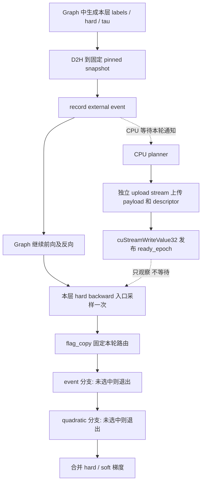

# Planner 启用时的 CUDA Graph：设计与阶段计划

记录日期：2026-10-23。代码基线：`510b3eb`。

状态：**设计记录，尚未实现。** 当前 `PackedTrainingGraph` 仍要求
`DISM_HARD_PLANNER=0`。本文记录本轮讨论选定的实现方向与验收边界，
不代表新的同步协议、persistent consumer 或整模型支持已经通过验证。
本轮只写文档；后续每个阶段分别实现、验证、记录结果，暂不做性能优化。

## 1. 目标和范围

在保留整段 microbatch 前向和反向 CUDA Graph 的前提下，让图外 CPU planner
为**本次 replay**生成计划；在每层 hard backward 入口由 GPU 采样是否就绪，
在 event-based hard backward 与 quadratic fallback 中选择一条执行。

首个集成目标为当前 packed、固定 true direction、sequence-row hard sampling、
BF16/MXFP8 FFN 模型：compact planner、C64、R32/DV64，策略为 `ready`。
初版保持同一个 runner 顺序执行，不支持重入或多个 replay 同时在途。
其它维度、classic metadata、强制等待的 `event` 策略需要单独验证或明确拒绝，
不能静默改变其语义。现有 eager planner、planner-disabled graph 保持可用。

必须保持：

- postnorm、前半 GDN/后半 GDN+DISM、固定 true direction、按原始训练行采样。
- soft/hard 数学、tau 梯度算法、BF16 补偿及已有数值验收标准。
- RNG counter、annealing buffers、参数别名、no-decay 分组、optimizer schema。
- checkpoint 的 consumed dataloader position；runtime graph/planner 状态不进 checkpoint。
- 词表 TMA 融合实验默认关闭。本任务不包含它，也不要求吞吐提升。

## 2. 已确认的现状

启用 `DISM_HARD_PLANNER=1` 时，默认是 compact + ready，16 workers、C64、
最多 32 个存活 ticket。当前流程为插值生成 labels → 保存 labels/hard/tau
快照 → D2H → CPU planning → metadata H2D → 反向在 host 检查就绪状态。
`future.done()` 只表示 CPU 工作结束；最终上传 event 完成才允许选择 event 路径。

主要代码入口：

| 入口 | 当前职责 / 后续涉及的变化 |
|---|---|
| [hard_training.py](../python/flash_dism/hard_training.py) | 单次调用 ticket、CPU coordinator、快照、ready/event/quadratic 路由 |
| [training_planner.py](../python/flash_dism/inference/training_planner.py) | native plan、动态 compact storage、上传与资源所有权 |
| [hard_backward_fused.py](../python/flash_dism/kernels/hard_backward_fused.py) | compact consumer、动态 grid、跨 stream event wait、tau reduction |
| [hard_backward.py](../python/flash_dism/hard_backward.py) | quadratic fallback 的 forward-state 重计算及反向 |
| [compiler.py](../python/flash_dism/compiler.py) | core/vocabulary custom op、saved tensors、两路梯度合并 |
| [frontend.cpp](../src/frontend.cpp) | CPU tensor Storage 持有 ticket 的 opaque handle |
| [graph_layout.h](../include/host/graph_layout.h) | 可复用的 packed metadata ownership、固定容量和 replay 前更新 |
| [cuda_graph.py](../../nanochat/nanochat/cuda_graph.py) | 整步 capture/replay、输入 staging、grad accumulation、当前固定 quadratic 路由计数 |

本轮信息收集运行了 ready dispatch、training defaults 和预生成计划 graph 测试，
共 **23 passed**。直接捕获未经修改的 compact consumer，在
`stream.wait_event(self.ready)` 复现 `cudaErrorStreamCaptureIsolation`，
随后 capture end 报 invalidated。已有 fused graph 测试先完成上传并移除
`device_plan` 等待，只覆盖固定计划下改变向量值的 replay，不能证明异步交接可用。

计划尺寸也不只由 token shape 决定。小型探针固定 B=2/H=2/N=512、C64：

| 输入 | 单 chunk blocks | 多 chunk streams / chunks | metadata bytes |
|---|---:|---:|---:|
| 随机 labels、全 hard | 702 | 0 / 0 | 185,336 |
| 重复 labels、全 hard | 5,032 | 52 / 168 | 1,580,280 |
| 全 soft | 0 | 0 / 0 | 8 |
| 随机 labels、改变文档边界 | 559 | 0 / 0 | 147,584 |

这些是结构探针，不是性能结果，也不是容量上界。

## 3. 选定的执行协议

以下操作按每个 hybrid layer、每次 replay 分别进行。`epoch` 是 runtime
generation，不是模型 RNG counter，也不替代 checkpoint 中的训练步。



### 3.1 Graph 到 CPU 的通知

Graph 拥有固定地址的 device snapshot 和 pinned host snapshot，D2H 完成后
记录 external event。当前 PyTorch 有 `torch.cuda.Event(external=True)`。
CUDA 的 event record node 会随每次 graph launch 重新记录；普通 capture event
可能只形成图内依赖，不能把它当作已实现的 CPU 通知协议。
参见 [CUDA 13.1 graph event record](https://docs.nvidia.com/cuda/archive/13.1.0/cuda-driver-api/group__CUDA__GRAPH.html)。

Host 在 `replay()` 提交返回后，才允许 coordinator 等待对应层的本轮 event。
必须验证重复 launch 时的 event 状态及 epoch 对应，不能让提前等待的线程读取
上轮完成状态或尚未记录的 event。每层通知独立；coordinator 派发任务后继续
处理后续层通知，不在同一通知循环里串行等待一个层的整个规划过程。

第一版可把 D2H 节点排在 graph 的执行链上；若以后改为旁支 copy stream，
必须单独验证 capture fork/join 和 snapshot 被复用前的依赖。
文档边界由 replay 前的 CPU staging 提供**本轮私有快照**，不能让后台任务
继续读取下一轮会被修改的 `layout.table`。

### 3.2 CPU 到 GPU 的发布

CPU planning 完成后，在独立的 nonblocking upload stream 上依次提交：

1. 本轮完整 metadata payload 和必要的派生数组上传/构建。
2. 本轮 descriptor 上传，其中包含 epoch、有效任务数和 payload/workspace 指针。
3. `cuStreamWriteValue32(..., ready_epoch, epoch, 0)`。

`ready_epoch` 的含义是“该 generation 的数据已可供消费”，不是“CPU 已算完”。
不能把 flag 写在 H2D 之前，也不能把它排在整步 graph 之后的同一个 stream 上。
采用正常 device memory、对齐的 32-bit flag；检查调用返回值和设备/API 支持。
默认 write 带前置 stream-scoped fence，不使用去掉 barrier 的选项。
参见 [CUDA 13.1 stream write flags](https://docs.nvidia.com/cuda/archive/13.1.0/cuda-driver-api/group__CUDA__TYPES.html)。

采样端需要与发布端匹配的可见性/ordering 协议。阶段 1 必须明确 acquire load
的 scope、编译后的指令及后续 consumer 的依赖，证明“观察到本轮 ready 就能
读到本轮完整数据”。不能用普通 load、`volatile`、经验测试通过或多加一个 fence
替代这项论证。若 `WriteValue32` 与选定消费原语的正式保证不足，先修订此小协议，
不把不明确的同步关系带入模型。

### 3.3 一次采样和互斥执行

在每层 soft backward 后、hard backward 前运行一个采样节点：

```text
flag_copy[layer] = (acquire_load(ready_epoch[layer]) == expected_epoch)
```

该节点完成后，两个分支及其所有 CTA 都读取同一个 `flag_copy`。
它在本轮消费完成前不可改写；不能由两个分支分别读 live ready flag。
采样后迟到的发布只影响资源回收，不能把当前 fallback 变成 event 路径。
采样不通过时不得解引用尚在上传的 descriptor 或 payload。

初版将两个分支顺序放在 graph 中，不要求并发。persistent/fixed-grid consumer
只遍历采样时已就绪的有限任务，未选中立即退出；不轮询等待 CPU，不在 GPU 上
用 `cuStreamWaitValue32` 等待 planner。CUDA 调度器不能根据内存 flag 推导调度
依赖，不能让正确性依赖跨 stream 并发执行或特定优先级。
参见 [CUDA 13.1 stream memory operations](https://docs.nvidia.com/cuda/archive/13.1.0/cuda-driver-api/group__CUDA__MEMOP.html)。

新的 `ready` 决策发生在 GPU 实际执行到该层时，旧实现发生在 CPU 提交反向时。
二者可能选择不同路径，因而不要求路径比例或浮点结果逐位相同；要求每一条被选
路径都消费同次前向的数据，并通过原有数值标准。强制等待的 `event` 策略不是
此协议的自动延伸，首版 graph 接口应明确限制策略。

## 4. 存储、生命周期与失败处理

### 4.1 首版资源模型

先采用**每个 graph instance 的每层一个固定 slot**。一个 slot 的固定部分包括：
device/pinned snapshots、external input-ready event、device expected/ready epoch、
`flag_copy`、device descriptor、路由结果和消费完成标记。多 slot ring 不是首版目标。

Graph kernel 参数保持固定的 descriptor 地址；descriptor 可提供本轮 compact
16/32/64 桶和 multi-stream 的指针、计数、offsets、tau-head mapping、workspace。
payload 和 workspace 在图外分配并由 runtime 保活，或者使用显式容量的 arena。
第一版优先验证 descriptor 间接寻址，不能声称 persistent launch 自动解决了存储问题。
不直接把 Python tensor 的可变 shape/指针固化为 graph kernel 参数。

所有容量、索引宽度和字节大小都需要检查；不能截断计划。显式配置的资源预算不足
可以记录原因并走 fallback；内存损坏、CUDA 错误和 planner 异常不能当作普通未就绪。
给在途 ticket 数量和总 metadata/workspace 字节都设置边界。

### 4.2 generation 与回收规则

每轮开始前设置新的非零 32-bit epoch；0 保留为未发布。epoch 回绕前必须完全排空
runtime 并重置 generation，不能让旧值重新匹配。generation 检查本身不保护 payload。

一个 slot 只有同时满足以下条件才可以复用、清零或释放：

- 本轮 graph 不再读取它，D2H 及所有消费节点已经完成。
- CPU coordinator/native workers 已停止读取 pinned snapshot 和文档快照。
- 已提交的 metadata H2D、派生工作及 flag write 都已结束。

即使 GPU 已选 fallback，迟到的 CPU/H2D 仍可能持有或写入此 slot。
不能仅凭 graph 完成就复用它，也不能只比较 epoch 后覆盖 metadata。
初版允许在**下一轮 replay 前的回收点**等待这些资源安全退役，以简化正确性；
这可能引入 CPU 时间，暂不优化。以后采用多 slot 必须同时设计 graph 捕获地址
与 slot 绑定方式，不能直接让 ring index 指向不同 pinned copy 目标。

任务阶段（D2H、planning、uploading、published、drained）与 GPU 路由结果
（未采样、event、quadratic）是两个独立状态，不能简化成一条线性状态链。
fallback 可以与 planning/uploading 同时发生。

### 4.3 异常、取消与训练边界

取消只能阻止尚未开始的工作或尚未提交的上传。不得释放已经排队的 copy 源/目标，
不得用 `Future.cancel()` 假装 CUDA 工作已结束。正在运行的 native 工作先 drain。
关闭 runner、capture 失败、提前丢弃模型、切换 evaluation 和 checkpoint 保存都
需要明确的 drain/close 路径；关闭过程不能依赖一个从未提交的 replay event。

CPU 错误进入独立 error channel，不发布 ready。GPU 可安全完成 fallback，但 host
必须发现错误并拒绝把失败步骤提交到 optimizer/checkpoint，不能静默忽略。
首版在 optimizer 更新前 drain 本步骤的剩余任务并检查错误；这是明确的正确性边界，
不是承诺无等待。资源预算导致的预期 fallback 与真实异常分别计数。

Runtime generation、slots、worker queues 和 graph handles 都不序列化。
恢复 checkpoint 后重建它们，完整保留模型 RNG、annealing、optimizer 和数据位置。

## 5. Kernel 改动边界

Event consumer 保留现有 compact 分桶、BF16 补偿、one-pair 分支、reset 语义和 tau
计算。改动集中于固定 grid、device task count、descriptor 间接寻址和统一分支门控。
single chunks、multi summaries、stream scan、multi chunk backward、tau reduction
仍可保留为多个节点，以节点依赖提供阶段间全局同步。不要引入普通 CTA 之间的
自旋全局 barrier。各阶段计数器/workspace 初始化必须每轮执行且符合门控规则。

[历史算法实验](PLANNER_BACKWARD_ALGORITHM_ANALYSIS.md) 中的 `persistent_tf32`
已因性能和数值问题被否决。这里的 persistent 仅用于固定 launch 下的动态任务遍历，
不继承那套数学或精度路径，也不因名称相同就视为已有实现。

Quadratic 门控覆盖整个 fallback：hard summary/chunk/log weights/readout 重计算、
反向主 kernel、dlog/tau reduction 及必要的合并。只门控主 backward 不够。
初版可为两路分别保留固定输出，先统一清零，再由被选中分支写入并合并；
未选中路径不得读无效 payload，也不得清除另一条路径已经写入的结果。

门控应在 TMA 发起、barrier 初始化或 shared pipeline 使用前由 CTA 一致地决定。
kernel 修改按仓库规则检查边界/同步、CALL/spills，运行相应 sanitizer；不使用
shared FP32 atomicAdd，不修改已有默认 launches 来追求性能。

## 6. 分阶段实施与验收

每个阶段应形成可独立审查的提交，包含实现、必要回归和文档结果；生产接入在后面。
验收失败先修复本阶段，不通过放宽 tolerance、默认强制 fallback 或隐藏异常进入下一阶段。

| 阶段 | 交付内容 | 依赖与退出条件 |
|---|---|---|
| P0：设计记录 | 本文、现状证据、接口边界与验收清单 | 本次完成；其余阶段均未开始 |
| P1：最小交接协议 | 不含 DISM 的 D2H/external event/CPU producer/H2D/WriteValue32/一次采样/双分支探针 | 重复 replay、及时/迟到发布、完整 payload 可见性、旧 epoch 拒绝、无 GPU 等待；记录 memory-ordering 论证 |
| P2：slot 与真实 planner runtime | 固定 snapshot、epoch/descriptor ownership、现有 native planner 接入、上传、回收、错误通道 | 基于 P1；label/hard/tau/doc 快照正确，旧 writer 不覆盖下一轮，资源预算与关闭/异常可控 |
| P3：固定 launch 的 event consumer | descriptor 驱动 compact 各阶段、动态有效任务数、workspace/tau 处理 | 基于 P2 的 descriptor；先用预生成计划验证同一 graph 下计划形状变化，数值和 sanitizer 通过 |
| P4：完整双路径门控 | quadratic 全链路门控、共享采样结果、输出初始化/合并 | 基于 P1/P3；每轮恰好一条 hard 路径生效，迟到发布不改变决定，未选中路径无无效读写 |
| P5：DISM core/vocabulary 接入 | capture 专用 runtime binding、D2H 节点、保存状态和梯度合并 | 基于 P2/P4；单层及多层完整前向反向，连续改变 labels/masks/tau/boundaries，旧 eager/AOT 回归通过 |
| P6：nanochat runner 接入 | replay 调度、预热与 capture、累积梯度、optimizer 前错误检查、实际 GPU 路由统计 | 基于 P5；小模型后再到当前模型，RNG/恢复/数据位置保持，限定支持组合并显式启用 |
| P7：完整验收与交付 | 跨轮压力、异常生命周期、数值与 sanitizer 证据、运行文档 | 所有必需项完成后才声明支持；保留默认 planner-disabled 行为，不做吞吐优化 |

### P1：先解决同步原语，不碰模型

在 `tools/` 放可复现的最小工具，`tests/` 放协议回归；native host 绑定和 CUDA TU
按现有 `build.py` 接入，device TU 保持 Torch-free。使用受控的 CPU gate 和 GPU
完成通知安排 ready/fallback 情况，不用依赖机器快慢的 sleep 作为唯一测试依据。
边界竞态允许选中任一合法分支，但必须全局一致、payload 完整，且不能重复写结果。
外部 event 与 WriteValue 的连通性尚未实测，P1 是后续设计的首个验证门槛。

### P2：先用轻量 consumer 检验真实计划

复用现有 `NativeTrainingPlanner` 的数学和 packing。初期 consumer 只检查 descriptor
与 metadata 内容，尚不计算真实梯度。验证逐轮从空计划变为 short/long/repeated
计划、文档数变化、CPU 输入快照不被修改，及有/无提交上传的取消路径。
Warmup/capture 与真实 replay 必须有独立状态：不能在 capture 时等待尚未执行的 D2H，
也不能让 warmup 的 ticket、错误或 generation 泄漏进第一轮训练。

### P3/P4：把数学验证与调度验证分开

P3 用图外预生成/上传的计划，单独证明 consumer 能读取新的 counts、指针和内容。
逐个改造短桶、multi summaries/scan/chunks、tau reduction，避免同时重写全部阶段。
P4 再接一次采样与完整 quadratic 分支；测试可在图外预发布或延迟发布以控制路由，
不为生产引入“强制 event 且 GPU 等待”的隐式新策略。

数值基线分别取原 compact consumer、原 quadratic 路径和 FP64 oracle。
保留 [precision](PLANNER_BACKWARD_PRECISION.md)、
[algorithm limitations](PLANNER_BACKWARD_ALGORITHM_ANALYSIS.md) 中已有失败诊断。
路由切换允许浮点次序差异，但新差异不能未经比较就归类为历史限制。

### P5/P6：逐层再整模型

先验证 core，再验证 vocabulary custom op，最后接模型。CPU tensor handle 可以继续
承载所有权，但不能沿用“capture 时创建一次 Future，replay 自动重新提交”的假设。
runtime binding 必须由 graph instance/layer 明确持有，不能建立裸指针全局 registry。

再接 `PackedTrainingGraph` 与训练循环：保留已有输入、packed layout、GDN、MXFP8
和梯度存储约束；每次 replay 只增加一次模型 RNG counter，预热/capture 恢复现场。
GPU route 结果在安全的日志/步骤边界读取，替换当前重放后固定记录 `q` 的逻辑。
实际 planner 异常在 optimizer 前上报；拒绝不支持的 policy/shape/lifecycle 组合。
正式 CLI 命名在本阶段确定，不能提前移除现有 planner capture guards。

## 7. 验收清单

| 方面 | 必须覆盖的情况 |
|---|---|
| 通知/发布 | external event 多轮复用、每层通知、payload/descriptor 上传顺序、采样前后完成、上传中采样、发布与采样竞争 |
| generation | 不发布、旧 epoch、跨轮迟到、drain 后复用、回绕策略；epoch 匹配不能掩盖错误 payload |
| 计划结构 | 全 soft/全 hard/混合原始行、random/repeat labels、空桶、多 chunk、不同 counts/指针、资源不足 |
| packed 语义 | changed/reused cu_seqlens、空文档、文档数量变化、256 对齐、跨原始训练行的非法文档拒绝 |
| 双路径 | event/quadratic 交替、迟到发布、两路输出完整性、tau/zero-grad、无重复累加、无未选中分支副作用 |
| 生命周期 | 多层、早期丢弃、未启动 replay、capture 失败、CPU exception、CUDA upload error、close、allocator 复用压力 |
| 数值 | 各路径独立 FP64 oracle、原路径对照、原 tolerance；记录 cosine/norm/偏差及未解决的 strict failures |
| 模型状态 | microbatch accumulation、两种 zero_grad、RNG/annealing、MXFP8 更新、evaluation 后恢复、checkpoint/resume 与 consumed data position |
| 工具检查 | 改动 kernel 的 memcheck/synccheck/racecheck、CALL/spills、工作树 imports、没有新增不受限内存增长 |

对异步交接的压力测试不能替代内存模型论证；sanitizer 零报告也不等于已证明
CPU/DMA 与 GPU flag 协议的全部跨域 ordering。保存测试范围和局限。

只用 conda `blkw` 和本工作树的 `flash_dism`/`cu_flash_dism`；native build 并行度
有界。测试使用 scratch 模型和合成数据，不下载数据、不启动外部训练、不修改用户
checkpoint。生成的日志、JSON、trace、cubin/SASS 放在忽略的 `dism_v3/build/` 下。

## 8. 待阶段内确认的问题

- P1：WriteValue32 发布与所选 acquire load/consumer 节点之间的完整内存顺序；
  external event 重录与 CPU 等待的本轮绑定，以及目标 CUDA/PyTorch API 的支持。
- P2：descriptor 的具体 ABI、错误通道、字节预算和同步退役接口。首版不承诺无等待回收。
- P3：运行时指针与 TMA/编译器约束；如需要 descriptor 或 map 更新，必须在发布前完成，
  不能暗中把旧指针捕获到 graph。各阶段固定 grid 大小先取保守值，不选性能最优值。
- P5/P6：正式 opt-in 接口、暂不支持的 policy/尺寸、checkpoint/evaluation drain 的确切位置。
- P7 之后：只有功能验收完成，再另行讨论多 slot overlap、队列调度、launch 数量和性能。

相关背景：[CUDA Graph 当前支持](CUDA_GRAPHS.md)、
[ready dispatch](HARD_READY_DISPATCH.md)、
[native planner](NATIVE_TRAINING_PLANNER.md)。
